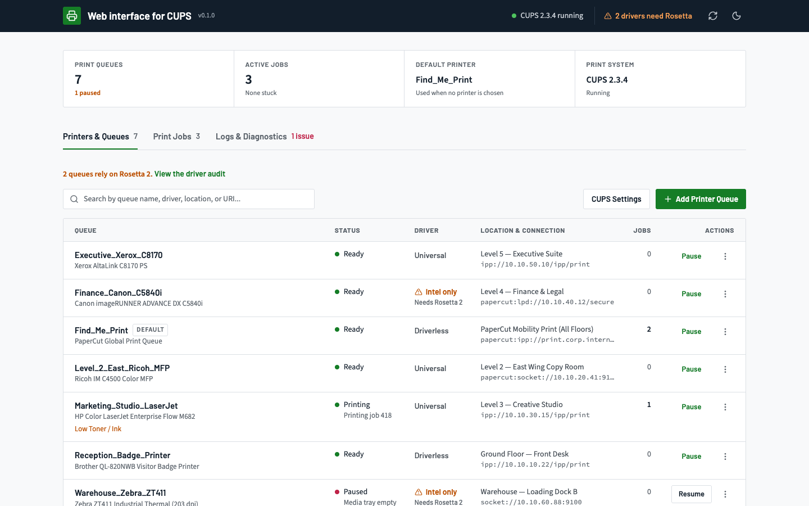

# CUPS webui

**Web interface for CUPS**: a modern, lightweight, single-binary replacement for the legacy CUPS web interface (`localhost:631`) on macOS.



Designed specifically to address UX barriers in macOS and UNIX environments:
- **Zero Configuration Access**: Bypasses the requirement to run `cupsctl WebInterface=yes` in Terminal.
- **Human-Centric UX**: Replaces technical abstractions (*PPDs*, *Classes*) with clear workflows (*Printers*, *Print Queues*, *Printer Pools*).
- **Modern Responsive Interface**: Clean dashboard that follows your Mac's light or dark appearance, built with Tailwind CSS and Lucide icons.
- **Queue Diagnostics & Stuck Job Remediation**: Identifies stuck print jobs and provides instant one-click cancellation.
- **Security-First**: Binds to loopback `127.0.0.1:6310` by default, and signs in only the macOS user who runs it. See [SECURITY.md](./SECURITY.md).

---

## Quick Start

A pre-compiled universal binary for macOS (supporting both Apple Silicon and Intel) is included directly in [`bin/cups-webui`](./bin/cups-webui), so you can run the app immediately without installing Go or Node.js.

### 1. Launch the Web Interface
Start the server and automatically open the interface in your browser:
```bash
./bin/cups-webui -open
```
The interface will be available at `http://127.0.0.1:6310`. Once the server is running, you can open (or bookmark) that address directly; no login step is needed for the user account that runs the server. Other accounts on the same Mac are not signed in.

### 2. Run as a macOS Background Service (LaunchAgent)
To have the interface start automatically in the background on login:
```bash
# Install the service and start it immediately
./bin/cups-webui launchagent install

# Check service status
./bin/cups-webui launchagent status

# Uninstall the service
./bin/cups-webui launchagent uninstall
```

The install command copies the binary to `~/Library/Application Support/cups-webui/` and starts the service straight away. Open `http://127.0.0.1:6310` in your browser and bookmark it.

### 3. Run in Mock Mode (For Testing / Demo)
Runs with simulated printers, queues, and diagnostic alerts without requiring active printer hardware:
```bash
./bin/cups-webui -mock -open
```

---

## CLI Options

| Flag | Default | Description |
| :--- | :--- | :--- |
| `-port` | `6310` | Port to listen on |
| `-host` | `127.0.0.1` | Host interface to bind to. Only loopback is supported |
| `-mock` | `false` | Run with simulated CUPS mock data |
| `-open` | `false` | Automatically open default browser on launch |

Subcommands:
- `cups-webui open` – Open the running server in your default browser using its session link
- `cups-webui launchagent [install|uninstall|status]` – Manage the macOS background LaunchAgent service

---

## Building from Source

If you would like to build or modify the project yourself:

### Prerequisites
- [Go](https://go.dev/) (1.26+)
- [Node.js](https://nodejs.org/) (20+) and `npm`

The Go code uses only the standard library, so `go.mod` lists no dependencies and there is no `go.sum` file.

### Build Steps
```bash
# Build the frontend SPA and compile the universal macOS binary (bin/cups-webui):
make build

# Or compile only the native Go binary for your current machine architecture:
make build-go

# Or build the frontend independently:
cd web && npm install && npm run build
```

### Running Tests
Run the Go test suite:
```bash
make test
```

---

## Architecture

- **Backend (`cmd/cups-webui/main.go`, `internal/api/`, `internal/cups/`)**: Pure Go, standard library only, using `net/http` and the native CUPS command-line tools (`lpstat`, `lpadmin`, `lpoptions`, `cancel`, `cupsctl`, `cupsdisable`, `cupsenable`).
- **Frontend (`web/`)**: React 19 + TypeScript + Tailwind CSS v4 SPA, compiled directly into `internal/web/dist` and embedded into the Go binary with `go:embed`.
- **Packaging**: Single executable (`./bin/cups-webui`) with zero runtime dependencies.

---

## Security

The security model is described in [SECURITY.md](./SECURITY.md). Please report suspected vulnerabilities through <https://www.papercut.com/contact/security/> and not as public issues.

## License

MIT. See [LICENSE](./LICENSE). Bundled fonts are covered by their own licences; see [THIRD_PARTY_NOTICES.md](./THIRD_PARTY_NOTICES.md).

## About This Project

CUPS WebUI (`cups-webui`) is an open-source project actively maintained by [PaperCut Software](https://www.papercut.com/), makers of print management software. It was built after Apple decided to remove the built-in CUPS Web Interface (`localhost:631`) in macOS 27 Golden Gate. Although admins can still use commands like `lpadmin` and `lpstat` to manage print queues and default settings, `cups-webui` offers a much easier way to manage them.

